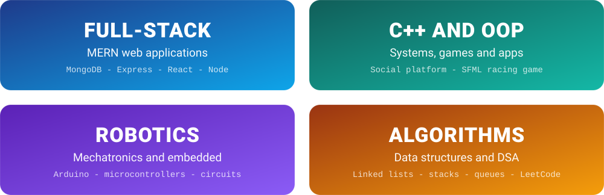
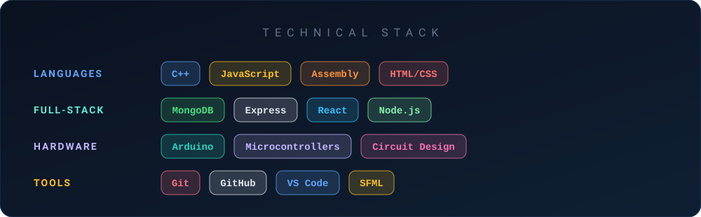
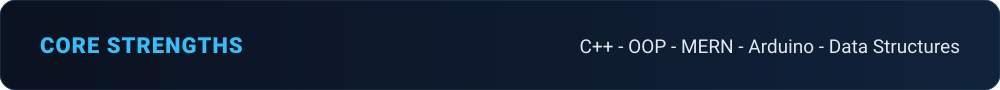

<div align="center">



<br>

🎓 **2nd Year BS Software Engineering** &nbsp;|&nbsp; 💼 **Open to Internships** &nbsp;|&nbsp; 📍 **Lahore, Pakistan**

[LinkedIn](https://www.linkedin.com/in/ali-abdullah-790991381) &nbsp;•&nbsp; [Email](mailto:x.ali.abdullah176@gmail.com) &nbsp;•&nbsp; [LeetCode Repo](https://github.com/aliabdullah-se/leetcode-solutions)

</div>

---

## 🎯 Focus Areas



---

## 👨‍💻 About

I'm a second-year Software Engineering student at **FAST-NUCES Lahore** combining a software degree with hands-on robotics and embedded-systems experience. I've built full-stack MERN applications, a complete social media application in C++ using object-oriented design, and a retro 1-player and 2-player racing game in SFML.

I'm deepening my data structures and algorithms through coursework and daily LeetCode practice, aiming for higher studies abroad and a career in software engineering.

```text
learn  ->  build  ->  compete  ->  repeat
```

**I'm open to software development internships. Let's talk.**

---

## 🏆 Experience and Achievements

| Area | Details |
|------|---------|
| 🤖 **Robotics and Mechatronics Competitions** | Multiple awards at leading universities including **UET**, **UCP** and **COMSATS** <br> *(add: competition name, position, year)* |
| 🛠️ **Professional Experience** | Mechatronics, Arduino, microcontrollers and circuit design <br> *(add: organization, role, duration)* |
| 📜 **Certifications** | Microsoft Office Specialist (MOS), Microsoft <br> Mechatronics, Arduino, microcontrollers and circuit design <br> *(add: certificate names and issuers)* |

---

## 🛠️ Technical Stack



---

## 📂 Featured Projects

| # | Project | Highlights |
|---|---------|------------|
| 01 | [**Connectify-New**](https://github.com/aliabdullah-se/Connectify-New) | Full social media application built from scratch with OOP in C++ |
| 02 | **Retro Racing Game** | 1-player and 2-player racing game - C++ - SFML |
| 03 | **MERN Web Applications** | Full-stack apps - MongoDB - Express - React - Node.js |
| 04 | [**Arduino-RC-Car-Project**](https://github.com/aliabdullah-se/Arduino-RC-Car-Project) | Adaptive cruise-controlled RC car - Arduino Uno - Bluetooth |
| 05 | [**leetcode-solutions**](https://github.com/aliabdullah-se/leetcode-solutions) | C++ solutions organized by topic with complexity notes |
| 06 | [**cs-fundamentals-rebuild**](https://github.com/aliabdullah-se/cs-fundamentals-rebuild) | Programming fundamentals and OOP as a path to data structures |
| 07 | [**COAL**](https://github.com/aliabdullah-se/Computer-Organization-and-Assembly-Language-COAL-) | Nasm - Intel 8088 - DOSBox - AFD debugger |

---

## 🌱 Currently

- 🔗 Linked lists, stacks and queues for Data Structures
- 💻 Daily LeetCode practice (NeetCode roadmap)
- 🎯 Seeking a software development internship

---




